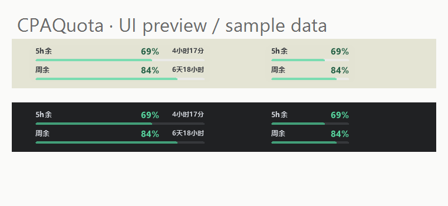

# CPAQuota

Windows 原生任务栏额度工具，通过 CPA 查看 Codex、Claude、Gemini、Antigravity 等账号的实时额度，可选连接 CPAMP 查看历史 Token 与请求量。

当前版本：**v0.6.4**（[更新记录](#更新记录)）

## 下载与运行

从 [GitHub Releases](https://github.com/songxff/CPAQuota/releases/latest) 选择：

| 版本 | 使用方式 | 配置位置 |
| --- | --- | --- |
| 安装版（Setup-x86.msi） | 双击安装，之后从开始菜单启动 CPAQuota；可从 Windows 应用列表卸载 | 当前用户的 %LOCALAPPDATA%\CPAQuota\data |
| 便携版（Portable-x86.zip） | 解压到可写文件夹，直接双击 CPAQuota.exe | EXE 同目录的 data |

需要 Windows 和 .NET Framework 4.8。x86 程序也可在常见的 x64 Windows 上运行。发行文件附带 SHA256SUMS.txt 校验值，当前版本未进行商业代码签名。

- **无需启动或停止 CMD。** 退出时右键任务栏面板或托盘图标 → 退出；再次运行 EXE 可打开现有实例的设置。托盘图标会始终保留，Windows 可能将它收纳在“显示隐藏的图标”中。
- **升级：** 安装版直接运行新版 MSI 即可覆盖升级，配置、账号选择和开机启动设置都会保留；便携版用新文件替换 CPAQuota.exe 和 CPAQuota.exe.config，保留 data 文件夹。
- 便携版请保留 portable.flag 和 CPAQuota.exe.config（启用高 DPI 支持）。安装版卸载时保留用户配置，并只清理本副本的开机启动项。旧版的同目录 data/desktop-settings.json 会继续识别。
- 两个发行包均不包含预置服务地址、账号或密钥。

## 首次配置与安全

首次启动会打开设置：填写自己的 CPA 服务地址与管理密钥（CPA 管理密钥不同于模型 API Key），CPAMP 历史统计按需启用。点击“测试连接”可在保存前确认账号能否读取。

- 密钥使用当前 Windows 用户的 DPAPI 加密保存，配置文件中没有明文。更换 Windows 用户或电脑后旧密钥无法解密，程序会直接提示并自动打开设置，重新输入即可。
- 远程服务使用 HTTP（非本机、非内网地址）时，保存前会提示密钥将以明文传输，建议改用 HTTPS。
- 程序直接请求 CPA/CPAMP，不需要浏览器、Node.js 或本地 HTTP 服务；不跟随重定向，避免密钥被转发到其他地址。

## 功能

- 显示五小时、周额度或渠道提供的模型额度，支持选择、切换和轮播账号。
- 支持已选账号的平均或累加百分比汇总，各周期显示有效账号数与最近已知重置时间。
- 百分比默认表示剩余，也可改为已用。
- 可选显示各周期的具体重置时间或倒计时；本地自动更新，不增加查询请求。
- 粗、细两种进度条样式；可按已用比例给进度条或百分比着色，颜色与阈值可配置。
- 默认透明背景，直接融入任务栏，文字按像素对齐渲染，高 DPI 下保持清晰。
- 点击查看完整额度、重置时间及历史统计；右键切换账号、刷新、设置或退出。
- 支持主题、字号、单双行、开机启动；宽度和左移偏移按实际屏幕像素应用。

## 任务栏显示方式

**Windows 10 横向任务栏**使用嵌入方式：面板放在任务栏内、托盘左侧，任务按钮区的右边缘收窄到面板左侧，不会盖住任务按钮；退出时恢复原布局。程序只管理任务按钮区的右边缘，可与 LiteMonitor 等从左侧嵌入任务栏的工具共存，反复启动、退出不会漂移。任务按钮区右侧另有工具栏分区时不做改动。

**Windows 11（Build 22000 起）及其他任务栏结构**使用独立置顶面板，定位在托盘左侧，避免误用旧任务栏窗口。此模式不为系统任务按钮预留空间，可用“左移”偏移避开已有按钮。全屏应用在前台时隐藏面板，桌面和另一显示器上的窗口不会被误判为全屏。

已验证：Windows 10 Build 19045（125% 缩放，与 LiteMonitor 同时嵌入）的启动、运行与退出；Windows 11 Build 26300 的面板可见性及定位。

整个额度面板（包括文字之间和四周的空白）均可点击打开详情或右键菜单。透明面板使用视觉不可察觉的点击底层，避免空白处点击穿透。

额度详情是紧凑的无标题悬浮框，显示账号、额度比例、重置时间及可选历史统计，按内容自动调整高度，支持高 DPI 和滚动。点击框外、按 Esc 或再次点击任务栏/托盘入口即可收起。命令行参数 `--details` 可直接打开详情。

设置窗口支持高 DPI 和调整大小，窄窗口中的配色选项自动改为单列，内容较多时可滚动；首次显示及切换 DPI 时会限制在当前显示器的工作区内。

## 额度与时间显示

**账号与指标 → 额度显示方式**可选当前单个账号、已选账号平均百分比、已选账号累加百分比。汇总当前账号所属渠道的已选账号；当前渠道没有勾选账号时使用第一个已选渠道。不同渠道、模型范围和周期分别计算，重复账号标识只计算一次。汇总模式停用账号轮播，可在详情中切换渠道或查看单个账号。

例如两个账号分别剩余 80%、40%：平均模式显示 60%，累加模式显示 120%。累加值可以超过 100%，但不同套餐的百分比不代表实际请求容量的总和。`[2/3]` 表示 3 个已选账号中有 2 个有效；失败、陈旧、到期及缺失的额度不参与对应周期的计算，无有效数据时显示“—”。历史 Token 仍显示当前单个账号的统计。

汇总时间采用每个周期参与账号中**最近已知的重置时间**，任务栏以“近”标记；5 小时与周额度独立计算。若部分账号未提供重置时间，详情会标明已知时间的账号数，并保留各账号各自的时间。某账号到期后，其旧额度暂时退出汇总，等待正常查询返回新周期。

**账号与指标 → 额度重置时间**可选不显示、具体时间、倒计时。具体时间跟随 Windows 时区，支持当天、明天、周日期及更远日期。未知或过期显示“—”，到期显示“等待刷新”。此项与额度查询刷新间隔（默认 120 秒）互相独立，倒计时在本地更新。开启时间后，双行宽度可参考 260–320 像素，单行通常需要更宽。

CPAMP 历史按北京时间自然日/月统计，仅包含其收集并保留的请求，不等同于订阅额度或网络流量。

## 外观

**外观与启动 → 进度条样式**：

- **粗进度条**（默认）：整行底色按已用比例填充，文字使用 Segoe UI。
- **细进度条**：行底部的细线，长度跟随显示的剩余/已用百分比（汇总累加超过 100% 时封顶），文字使用微软雅黑 UI。

**额度配色**可选默认、仅进度条、仅数字、进度条与数字四种模式。默认和仅数字模式不显示进度条。颜色按已用比例判断：低于 50% 绿色、50% 至低于 90% 黄色、90% 及以上红色，各周期独立计算，颜色和阈值均可自定义。读取失败、额度未知或数据过期时不显示进度条。

**外观与启动 → 透明背景（融入任务栏）**默认开启，逐像素透明绘制，保留系统任务栏原有背景；文字使用与不透明模式相同的系统字体渲染并对齐到整像素。关闭后显示柔和的圆角底色。主题决定文字深浅，可跟随 Windows 或手动选择。所有外观改动在设置中实时预览，保存并应用后立即生效。

## 故障排查

| 文件 | 内容 |
| --- | --- |
| data/desktop-settings.json | 配置（密钥为 DPAPI 密文） |
| data/desktop-status.json | 运行状态：版本、任务栏模式与位置、最近错误，约每 30 秒更新 |
| logs/desktop.log | 异常记录，含完整异常信息 |

安装版位于 %LOCALAPPDATA%\CPAQuota，便携版位于 EXE 同目录。

- **面板显示“连接异常”**：点击面板查看详情中的错误，或打开设置“测试连接”。
- **配置文件损坏**：程序会将其备份为 `desktop-settings.json.corrupt-时间`，以默认设置启动并提示重新填写连接。
- **日志**：60 秒内重复的同一异常只计数一次，日志超过 1 MB 自动轮换为 desktop.log.1。
- **上游拒绝查询**：Codex 与 Antigravity 查询使用的客户端标识可在配置文件的 `CodexUserAgent`、`AntigravityUserAgent` 中调整（退出程序后编辑，留空恢复默认）。

## 项目结构

    CPAQuota.sln
    src/CPAQuota/              应用源码、项目文件和 Assets
    tests/CPAQuota.Tests/      独立测试程序，不随发行包发布
    installer/                MSI 定义和两种发行版说明
    scripts/                  构建、测试、打包脚本
    docs/                     展示文档
    artifacts/                本机构建、测试和发布产物（不提交）

src/CPAQuota 按职责分为四层，每个文件对应一个主要类型：

| 层 | 文件 | 职责 |
| --- | --- | --- |
| 入口 | Program.cs | 命令行参数、单实例、异常日志挂钩 |
| | TaskbarApp.cs | 主程序：任务栏面板、托盘、详情与设置窗口的协调和每秒定时器 |
| | CommandHost.cs | 隐藏窗口，接收后续启动发来的“打开设置/详情、退出”命令 |
| | AppLog.cs | 带限流和轮换的异常日志 |
| 数据 | AppConfig.cs | 配置读写、DPAPI 密钥、地址校验、开机启动 |
| | Models.cs | 账号、额度窗口、快照等数据模型 |
| | QuotaService.cs | 轮询 CPA/CPAMP：账号列表、各账号额度、历史统计，线程安全 |
| | QuotaParser.cs | 解析 CPA、Codex、Claude、Google 与 CPAMP 的返回数据 |
| | QuotaAggregation.cs | 多账号平均/累加汇总 |
| | Json.cs | 宽松的 JSON 读取与格式化工具 |
| 显示 | QuotaStrip.cs | 任务栏面板窗口（分层透明）与设置页预览 |
| | Look.cs | 面板绘制、配色、显示数据的选取 |
| | QuotaColors.cs / QuotaReset.cs | 用量配色与进度条；重置时间与倒计时文字 |
| | TransparentText.cs | 透明背景上的像素对齐文字渲染 |
| | DetailsForm.cs / DetailsCanvas.cs | 额度详情悬浮框及其内容 |
| | SettingsForm.cs / SettingsControls.cs | 设置窗口；单选组与表格布局辅助 |
| 系统 | Taskbar.cs | 嵌入 Windows 10 任务栏或兼容模式定位、任务按钮区让位 |
| | NativeMethods.cs | Win32 声明与分层窗口输出 |
| | ShellDiagnostics.cs | `--inspect-shell` 诊断信息 |

源码使用带 BOM 的 UTF-8，代码风格由 .editorconfig 定义，可用 `dotnet format whitespace src --folder` 统一格式。目标为 C# 5（系统自带编译器），不使用 `?.`、字符串插值等新语法。

## 构建、测试与打包

编译应用与独立测试程序：

    powershell.exe -NoProfile -ExecutionPolicy Bypass -File .\scripts\Build.ps1

运行测试：

    powershell.exe -NoProfile -ExecutionPolicy Bypass -File .\scripts\Test.ps1

应用输出为 artifacts/build/CPAQuota.exe 和 CPAQuota.exe.config，测试报告在 artifacts/tests/。55 项测试覆盖解析、缓存、故障隔离、DPAPI 与解密失败提示、损坏配置恢复、配色、时间、多账号汇总与过期处理、实际像素、存储选择、任务栏模式与任务按钮区让位、设置与详情自适应布局，以及详情失焦收起、关闭重开和滚动行为。另可在交互桌面运行测试程序的 `--smoke-taskbar` 参数，用示例数据短时检查面板可见性。

打包需要 WiX Toolset 5：

    dotnet tool install --global wix --version 5.0.2
    powershell.exe -NoProfile -ExecutionPolicy Bypass -File .\scripts\Package.ps1

打包脚本会准备匹配的 WiX UI 扩展，先构建并通过测试，然后在 artifacts/releases/ 生成安装版、便携版和 SHA256SUMS.txt。版本号取自 src/CPAQuota/AssemblyInfo.cs（发布时同步修改 Assets/app.manifest）。首次准备打包依赖需要联网。发布包通过明确的文件清单组装，不包含测试程序或运行时配置。

## 内存与后台开销

采用 x86 构建、详情窗口按需创建、直接复制配置、字体复用和按显示变化重绘。缓存未过期的轮询不访问接口，也不通知界面刷新；隐藏的详情窗口不在后台重建，状态文件写入有节流，系统主题最多每 5 秒读取一次。

v0.6.0 在相同配置、重启后 60 秒的对比中，工作集约 53 MB 降至 36 MB，私有提交内存约 39 MB 降至 30 MB，未使用强制清空工作集。实际数值随环境、账号数量、窗口与运行时长变化。

## 配置与发布

个人 data/、日志、构建产物及备份均已忽略。转交便携文件夹前，应移除自己的 data 和 logs。不要上传个人地址、密钥或 DPAPI 密文；公开测试只使用 example.test 域名与测试字符串。

## 更新记录

### v0.6.4

- 透明背景下的文字改为像素对齐渲染，高 DPI 下不再发虚。
- 新增进度条样式：粗进度条（默认）/ 细进度条。
- Windows 10 嵌入模式不再盖住最右侧的任务按钮，并可与 LiteMonitor 等嵌入工具共存。
- 日志记录完整异常信息，重复异常限流并自动轮换。
- 密钥无法解密时明确提示并打开设置；配置文件损坏时自动备份并以默认设置启动。
- 远程 HTTP 地址保存前提示明文传输风险；上游客户端标识可配置。
- 卸载时等待程序退出后再删除文件；降低后台开销。

### v0.6.0

- 去掉启动/停止 CMD，直接运行 EXE，右键菜单退出。
- 提供安装版（MSI）与便携版（ZIP）；安装版配置位于 %LOCALAPPDATA%\CPAQuota\data，便携版位于 EXE 同目录。
- 测试程序与正式 EXE 分离，不包含在发行包中。
